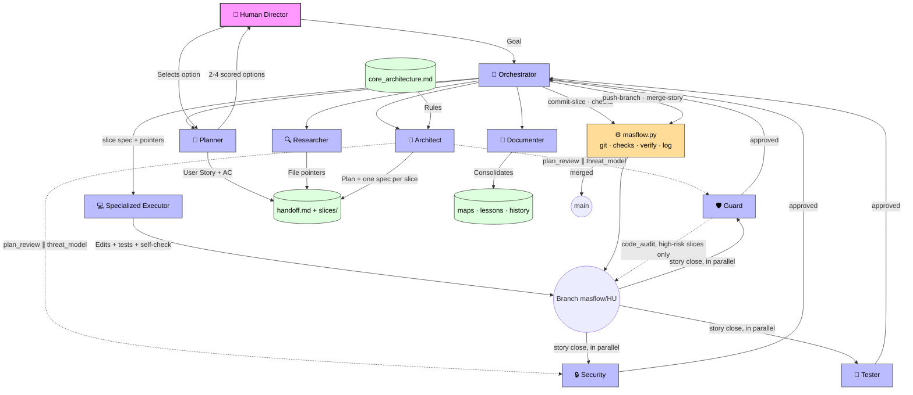

# MAS-Flow (Multi-Agent System Flow)

**MAS-Flow** is an open-source methodology for orchestrating AI Agents (LLMs) in complex software development projects.

Unlike autonomous agents that hallucinate or destroy your project's architecture, MAS-Flow enforces **Human-in-the-Loop orchestration**, **Ephemeral Context**, and **Strict Architectural Constraints**.

## 🧠 How it Works (The Flow)



Unlike human-oriented methodologies (like Scrum), which use sprints and meetings to synchronize context, **MAS-Flow** optimizes the asynchronous work of LLMs through external shared memory, strict separation of concerns, and gates sized by what they catch.

## 🚀 Key Features

1. **AI Orchestrator**: A central agent that reads `handoff.md` and delegates every task to exactly one specialized agent. It never writes code and works with "pointers" instead of raw source code.
2. **Models think, scripts do**: Git, deterministic checks, the daily full-suite verify, logging and archiving are `masflow.py` commands — seconds, no model, the same result every time.
3. **Strategic Planning & Tracks**: The `Planner` classifies the change (`fast` / `standard` / `full`), proposes 2-4 scored options and splits anything too big for one story. The Human picks; the track decides how much pipeline the change needs.
4. **Pointer-Based Research**: The `Researcher` is the only agent that searches the codebase. It returns file paths and line ranges; executors read only what they need.
5. **Contract-Level Plans, Slice by Slice**: The Architect splits the story into small slices (max 3-4 files, one layer, one bounded context), each with its own spec file: contracts, files and named tests — not code. All slices commit on one story branch (`masflow/<HU>`).
6. **Gates Sized by Risk**: The plan is reviewed (architecture and threat model) before any code exists. Every slice gets deterministic checks; only high-risk slices get an audit of their own. The whole story is audited and tested once, in parallel, before an automatic merge.
7. **Independent Verification**: The agent who writes the code never audits it. At story close the Guard checks, per acceptance criterion, that its test would fail without the behaviour, and the Security auditor reads the whole diff assuming it may be hostile.
8. **Context Budgets**: The handoff, the slice specs and the rules have size limits enforced by `masflow.py check`, because every agent re-reads them on every run.
9. **Learning Loop**: Repeated rejections — and defects that escaped every gate — become deterministic checks when a tool can catch them, or role-scoped *Active Rules* otherwise. Rules have a budget, so they are retired as well as added.
10. **Measured**: `masflow.py stats` shows lead time per story, runs versus rejections per gate and time per agent, so the flow is tuned with data.

## 🧩 What MAS-Flow gives a project

| Portable (this repository) | Owned by each project |
|---|---|
| Principles: [Manifesto](MANIFESTO.md), [Protocol](docs/protocol.md) | `masflow.config.json` — projects, test and check commands, budgets, gate policy, environment rules, models, command guard |
| Product cartography: `/masflow map` builds a product map (capabilities), functional and repository maps from the code; a board tracks every task | |
| Core agents: `agents/core/` (orchestrator, planner, researcher, architect, executor, tester, guard, security, fixer, documenter) + shared protocol | `.masflow/agents/` — project-specific agents or specializations (`extends:`) |
| Stack packs: `agents/packs/` (`laravel`, `shopify`) | `.masflow/` state — handoff, slice specs, board, product/functional/repository maps, core_architecture, lessons, history, event log |
| Templates for every state file | |
| `scripts/masflow.py` — `init`, `sync`, `status`, `check`, `stats`, and the pipeline commands `log`, `git`, `checks`, `verify`, `archive-story` | |
| Runtime integrations: Claude Code (subagents, `/masflow` skill, hooks) and OpenCode | |

## ⚡ Adopting MAS-Flow in a project

### Requirements

- **Python 3.10+** (standard library only, nothing to `pip install`) for `scripts/masflow.py` and the hooks.
- **Git**: every project listed in the config must be a git repository with a main branch (`main` by default); each story lives on its own branch.
- **A runtime**: [Claude Code](https://claude.com/claude-code) (subagents, `/masflow` skill, hooks) or OpenCode. The default agent models are Claude models; change them under `models` in the config.
- Your project's own toolchain (test runner, linters, containers) — MAS-Flow only calls the commands you put in the config.

### Install

```bash
cd /path/to/workspace                        # the folder that contains your project(s)
git clone https://github.com/jarloyz/MAS-flow.git MAS-Flow   # or a git submodule
python3 MAS-Flow/scripts/masflow.py init     # asks project name, packs, test command… (--yes = defaults)
```

The folder must be named `MAS-Flow` and sit at the workspace root: the generated hooks and agents reference `MAS-Flow/...` paths.

`init` creates `masflow.config.json`, the `.masflow/` state files and the runtime agents, and makes `CLAUDE.md` import the generated MAS-Flow instructions. Then:

1. Describe your stack and rules in `.masflow/core_architecture.md` — every agent obeys it.
2. Review `masflow.config.json`: projects, test commands (`{project}`/`{workspace}` placeholders), `slice_checks` (deterministic checks with a `{files}` placeholder), `acceptance` commands, `security_checks` for the security auditor (e.g. `composer audit`, `npm audit`, a secret scanner), budgets, gate policy, environment rules, blocked host commands, models.
3. Add project-specific agents in `.masflow/agents/` (e.g. `executor_billing.md` with `extends: executor_laravel`).
4. `python3 MAS-Flow/scripts/masflow.py sync` after any change, `check` to validate (config, prompts and context budgets).
5. In Claude Code: `/masflow map` to map what already exists, then `/masflow board` and `/masflow <goal or card>`. One session per story; `/masflow verify` at the end of the day; `/masflow stats` to see where the time goes.

Updating the methodology later is just replacing the `MAS-Flow/` folder (or pulling the submodule) and running `sync`: the project's config, agents and state are never overwritten.

Runtimes: **Claude Code** — see [Running MAS-Flow with Claude Code](docs/claude_code.md). **OpenCode** — add `"opencode"` to `runtimes` in the config (writes `.opencode/agents/`; models stay in `opencode.json`).

## 📂 Methodology Structure

To adopt MAS-Flow, please read our methodology documentation:

- [The Manifesto (Principles)](MANIFESTO.md)
- [Roles Definition](docs/roles.md)
- [Workflow](docs/workflow.md)
- [Architecture Context](docs/architecture_context.md)
- [Execution Guide (running it by hand or with another framework)](docs/execution_guide.md)
- [Practical Example (Step-by-Step)](docs/example_flow.md)
- [Recommended Tools](docs/tools.md)
- [Protocol (state files, budgets, statuses, tracks, gates, learning loop)](docs/protocol.md)
- [Running MAS-Flow with Claude Code](docs/claude_code.md)

## 🛠️ Without a supported runtime

MAS-Flow is a methodology first. With any other framework (LangGraph, CrewAI, AutoGen, custom scripts) — or by hand — keep the essentials: the roles in `agents/core/`, the [protocol](docs/protocol.md) (single-writer handoff, canonical statuses, context budgets, slice cycle, story close, Human gates), the state files in `templates/` and the `masflow.py` commands for the mechanical steps. See the [Execution Guide](docs/execution_guide.md).

## 🧪 Developing MAS-Flow

```bash
python3 -m unittest discover -s scripts/tests -t scripts
```

The tests cover the CLI (git lifecycle, logging, checks, verify, budgets, stats) and lint the prompts and docs: every agent renders for every runtime, statuses are canonical, the core stays stack-neutral, and the docs do not describe steps the pipeline no longer has.

## 📜 License

Distributed under the MIT License.
