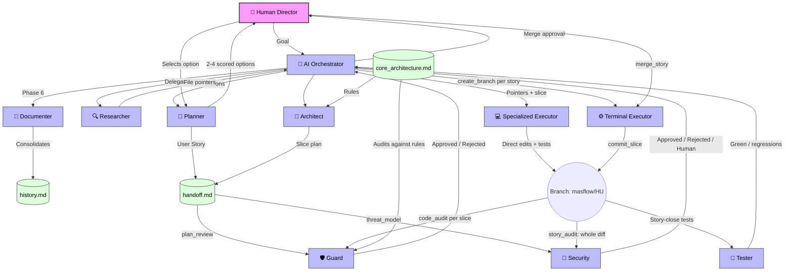

# MAS-Flow (Multi-Agent System Flow)

**MAS-Flow** is an open-source methodology for orchestrating AI Agents (LLMs) in complex software development projects.

Unlike autonomous agents that hallucinate or destroy your project's architecture, MAS-Flow enforces **Human-in-the-Loop orchestration**, **Ephemeral Context**, and **Strict Architectural Constraints**.

## 🧠 How it Works (The Flow)



Unlike traditional human-oriented methodologies (like Scrum), which use sprints and meetings to synchronize context, **MAS-Flow** optimizes the asynchronous work of LLMs through external shared memory, strict separation of concerns, and rigorous architecture validation.

## 🚀 Key Features

1. **AI Orchestrator (The Brain)**: A central agent that reads `handoff.md` and delegates every task to exactly one specialized agent. It never writes code and works with "pointers" instead of raw source code.
2. **Strategic Planning & Tracks (Phase 1.5)**: The `Planner` classifies the change (`fast` / `standard` / `full`) and proposes 2-4 scored options (DDD, SOLID, tech debt, reuse, risk, cost). The Human picks one; the track decides how much pipeline the change needs.
3. **Pointer-Based Research**: The `Researcher` is the only agent that searches the codebase. It returns file paths and line ranges; executors read only what they need.
4. **Slice-Based Execution on Git Branches**: The Architect splits the plan into small slices (max 3-4 files, one layer, one bounded context). All slices of a story commit on one branch per repository (`masflow/<HU>`): the executor edits files directly, writes its tests and runs a small self-check, the `Terminal Executor` commits, and the Guard audits each slice. The story is merged only after the security audit and the story-close tests are green and the Human approves.
5. **Zero Context Loss**: Through the "Handoff Protocol" (`handoff.md` file), agents maintain a perfect shared memory and can run statelessly.
6. **Independent Auditing**: The agent who writes the code is not the same one who audits it. The *Tester* only runs tests and the *Guard* only audits (SOLID, DDD, OWASP); failures go back to the original executor (then the *Fixer*, if the Human chooses it).
7. **Adversarial Security Review**: The *Security* auditor assumes AI-written code may be wrong **or hostile** (prompt injection, poisoned or invented dependencies, hidden instructions). It writes a threat model for the plan (every realistic abuse case needs a control and a negative test) and, at story close, reads the whole diff for backdoors, changes outside the plan or to the guardrails, supply-chain risks, secrets, access control, injection and AI-specific risks. A suspected backdoor stops the pipeline for the Human.
8. **Learning Loop**: Rejections from the Tester and Guard are logged; causes that repeat become binding *Active Rules* in `lessons.md`, audited on every slice.
9. **Project-Specific Architecture**: The methodology uses a dedicated Architecture Context (`core_architecture.md`) so agents always know exactly what tech stack (e.g., Laravel PHP 8.3, PHPUnit) they are working with.

## 🧩 What MAS-Flow gives a project

| Portable (this repository) | Owned by each project |
|---|---|
| Principles: [Manifesto](MANIFESTO.md), [Protocol](docs/protocol.md) | `masflow.config.json` — projects, test commands, environment rules, models, command guard |
| Product cartography: `/masflow map` builds a product map (capabilities), functional and repository maps from the code; a board tracks every task | |
| Core agents: `agents/core/` (orchestrator, planner, researcher, architect, executor, terminal_executor, tester, guard, security, fixer, documenter) + shared protocol | `.masflow/agents/` — project-specific agents or specializations (`extends:`) |
| Stack packs: `agents/packs/` (`laravel`, `shopify`) | `.masflow/` state — handoff, board, product/functional/repository maps, core_architecture, lessons, history |
| Templates for every state file | |
| `scripts/masflow.py` — `init`, `sync`, `status`, `check` | |
| Runtime integrations: Claude Code (subagents, `/masflow` skill, hooks) and OpenCode | |

## ⚡ Adopting MAS-Flow in a project

### Requirements

- **Python 3.10+** (standard library only, nothing to `pip install`) for `scripts/masflow.py` and the hooks.
- **Git**: every project listed in the config must be a git repository with a main branch (`main` by default); slices live on branches.
- **A runtime**: [Claude Code](https://claude.com/claude-code) (subagents, `/masflow` skill, hooks) or OpenCode. The default agent models are Claude models; change them under `models` in the config.
- Your project's own toolchain (test runner, linters, containers) — MAS-Flow only calls the commands you put in the config.

### Install

```bash
cd /path/to/workspace                        # the folder that contains your project(s)
git clone https://github.com/jarloyz/MAS-flow.git MAS-Flow   # or a git submodule
python3 MAS-Flow/scripts/masflow.py init     # asks project name, packs, test command… (--yes = defaults)
```

The folder must be named `MAS-Flow` and sit at the workspace root: the generated hooks and agents reference `MAS-Flow/...` paths.

`init` creates `masflow.config.json`, the `.masflow/` state files and the runtime agents, and makes `CLAUDE.md` import the generated MAS-Flow instructions. Then:

1. Describe your stack and rules in `.masflow/core_architecture.md` — every agent obeys it.
2. Review `masflow.config.json`: projects, test commands (`{project}`/`{workspace}` placeholders), deterministic checks for the guard (`checks`) and the security auditor (`security_checks`, e.g. `composer audit`, `npm audit`, a secret scanner), environment rules, blocked host commands, models.
3. Add project-specific agents in `.masflow/agents/` (e.g. `executor_billing.md` with `extends: executor_laravel`).
4. `python3 MAS-Flow/scripts/masflow.py sync` after any change, `check` to validate.
5. In Claude Code: `/masflow map` to map what already exists, then `/masflow board` and `/masflow <goal or card>`.

Updating the methodology later is just replacing the `MAS-Flow/` folder (or pulling the submodule) and running `sync`: the project's config, agents and state are never overwritten.

Runtimes: **Claude Code** — see [Running MAS-Flow with Claude Code](docs/claude_code.md). **OpenCode** — add `"opencode"` to `runtimes` in the config (writes `.opencode/agents/`; models stay in `opencode.json`).

## 📂 Methodology Structure

To adopt MAS-Flow, please read our methodology documentation:

- [The Manifesto (Principles)](MANIFESTO.md)
- [Roles Definition](docs/roles.md)
- [Workflow](docs/workflow.md)
- [Architecture Context](docs/architecture_context.md)
- [Execution Guide (Prompts & Mechanics)](docs/execution_guide.md)
- [Practical Example (Step-by-Step)](docs/example_flow.md)
- [Recommended Tools](docs/tools.md)
- [Protocol (state files, statuses, tracks, gates, learning loop)](docs/protocol.md)
- [Running MAS-Flow with Claude Code](docs/claude_code.md)

## 🛠️ Without a supported runtime

MAS-Flow is a methodology first. With any other framework (LangGraph, CrewAI, AutoGen, custom scripts), keep the essentials: the roles in `agents/core/`, the [protocol](docs/protocol.md) (single-writer handoff, canonical statuses, slice cycle, Human gates) and the state files in `templates/`.

## 📜 License

Distributed under the MIT License.
