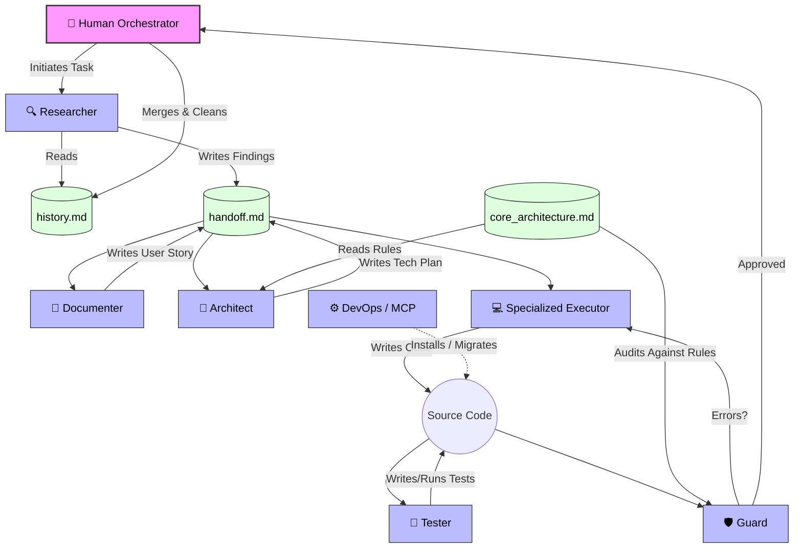

# MAS-Flow (Multi-Agent System Flow)

**MAS-Flow** is an open-source methodology for orchestrating AI Agents (LLMs) in complex software development projects.

Unlike autonomous agents that hallucinate or destroy your project's architecture, MAS-Flow enforces **Human-in-the-Loop orchestration**, **Ephemeral Context**, and **Strict Architectural Constraints**.

## 🧠 How it Works (The Flow)

Unlike traditional human-oriented methodologies (like Scrum), which use sprints and meetings to synchronize context, **MAS-Flow** optimizes the asynchronous work of LLMs through external shared memory, strict separation of concerns, and rigorous architecture validation.

## 🚀 Why MAS-Flow?

1. **Continuous Flow over Sprints**: Agents work at the speed of computation. They don't need to be isolated in a two-week sprint. MAS-Flow processes tasks as they arrive, keeping the backlog dynamic.
2. **Zero Context Loss**: Through the "Handoff Protocol" (`handoff.md` file), agents maintain a perfect shared memory at all times.
3. **Independent Auditing**: The agent who writes the code is not the same one who audits it. Roles like the *Guard* ensure the code respects architectural rules (SOLID, DDD) before moving to the next step.
4. **Human-in-the-Loop (HITL)**: The human transitions from a programmer to a "Director" or "Chief Architect", approving user stories and validating final Pull Requests.
5. **Project-Specific Architecture**: The methodology uses a dedicated Architecture Context (`architecture.md`) so agents always know exactly what tech stack (e.g., Laravel PHP 8.2 vs Python) they are working with.

## 📂 Methodology Structure

To adopt MAS-Flow, please read our methodology documentation:

- [The Manifesto (Principles)](MANIFESTO.md)
- [Roles Definition](docs/roles.md)
- [Workflow](docs/workflow.md)
- [Architecture Context](docs/architecture_context.md)
- [Execution Guide (Prompts & Mechanics)](docs/execution_guide.md)
- [Practical Example (Step-by-Step)](docs/example_flow.md)
- [Recommended Tools](docs/tools.md)

## 🛠️ Getting Started

MAS-Flow is not dependent on a specific coding framework. You can implement it using tools like LangChain, CrewAI, AutoGen, or even by orchestrating custom scripts. The important part is to respect the **flow architecture and roles**.

1. Read the [Manifesto](MANIFESTO.md) to understand the philosophy.
2. Define the [Roles](docs/roles.md) in your multi-agent system.
3. Define your project's stack in the Architecture Context.
4. Implement the `handoff.md` file in your repository.
5. Start the flow!

## 📜 License

Distributed under the MIT License.
